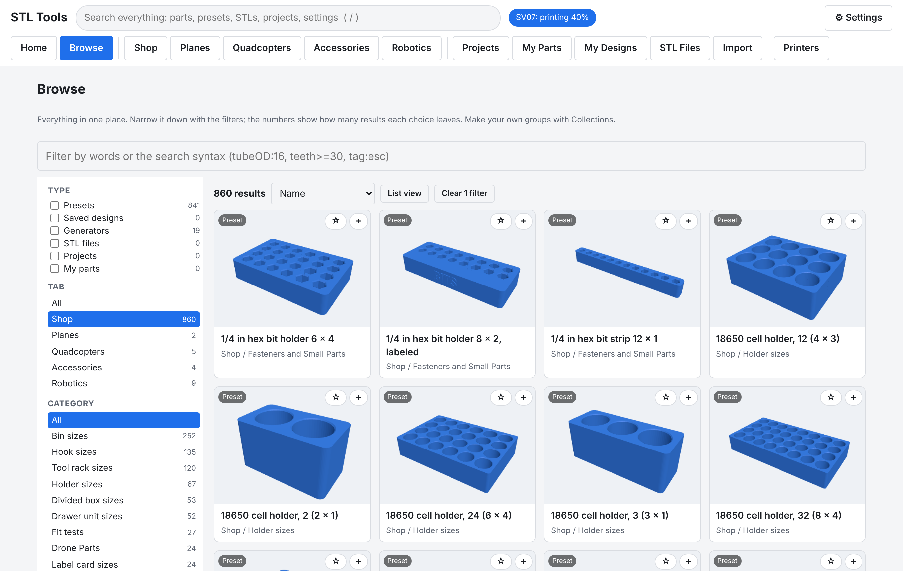
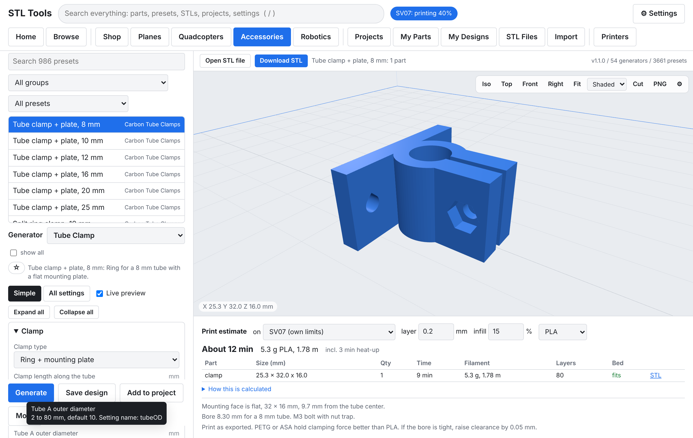

# STL Tools

**Version 1.0, open source (Apache-2.0).** A parametric STL generator for drones, RC planes, robotics and the workshop. Pick one of **3,661 ready-made designs** from **54 generators**, change any size, see the print time and filament for your printer, and download watertight STL files that are already in print orientation.

Examples: tube clamps and joints for any tube size, Raspberry Pi cases, sensor and lidar brackets, flight controller mounts, servo and brushless gimbals, gears and pulleys, bearing blocks, battery cell holders, drawer units, stacking bins, hooks and tool racks.

It runs on a Windows or Linux desktop (the main target), macOS or a Raspberry Pi, and opens in your browser or as its own app window. Nothing is uploaded anywhere: STL Tools is a small local server on your own computer.


## Quick start

1. Open [Releases](https://github.com/opsecfreak/STLTools/releases) and download the newest file for your computer (Windows, macOS Apple / Intel, Linux, Raspberry Pi 64 / 32-bit). Each package includes Node.js.
2. Unpack it and start it: **Start STL Tools.bat** (Windows), **STL Tools.app** (macOS), `./start.sh` (Linux / Pi).
3. On **Home**, press a **Make something** button (for example *Tube clamp*), set the sizes, press **Download STL**.

Full steps: [docs/INSTALL.md](docs/INSTALL.md). From source: [Run from source](#run-from-source-developers).

## What it does

| | |
|---|---|
| **Designer** | Every size is a field. **Simple** mode shows the main sizes, **All settings** shows every wall, clearance and screw. Live preview rebuilds the part as you type. |
| **3,661 presets** | Hand-made designs plus about 3,200 checked size series (clamps per tube size, spacers per bolt and length, gears, pulleys, 32 bearing sizes, cell holders, drawers...). Every series preset is generated and checked before it ships. |
| **Browse and organize** | **Browse** filters everything by type, tab, category, generator, tags, size series, measuring status and your own **Collections**. Favorites, global search (`/`) with a query syntax (`tubeOD:16`, `teeth>=30`, `tag:esc`). |
| **Assemblies** | Multi-part designs shown put together or as a print plate: servo pan-tilt gimbal, brushless 2-axis gimbal frame, drawer unit. Projects can place any parts together in 3D. |
| **Print estimates** | Time, grams, metres and cost per part and in total, bed-fit check, for your printer profile (Sovol SV07 and generic profiles included; add yours: [docs/PRINTER-PROFILES.md](docs/PRINTER-PROFILES.md)). |
| **Projects** | Parts lists with quantities, notes and printed checkboxes, one-ZIP download with a parts list, export / import between computers. |
| **My Parts** | Your own parts list (Owned / Confirm / Planned) with sizes and "needs measurement" flags; filter presets to what you own. Start from the example list or import your own `components.json` ([format](seed/example/README.md)). |
| **No guessed sizes** | Sizes nobody measured stay empty and Generate waits until you type them. Datasheet values are highlighted to check. |
| **STL Files** | Import STL files you already have: view, estimate, tag, add to projects. |
| **Printers (view only)** | Status, temperatures, progress, files, history and webcam of Klipper / Moonraker printers (Mainsail, Fluidd, Sovol SV07) on your LAN, plus G-code upload that never starts a print ([docs/PRINTERS.md](docs/PRINTERS.md)). |
| **Help where you need it** | Tooltips on every setting with its range, default and name; Settings > Tooltips and help sets delay, size and where help text shows. |
| **CLI and API** | `stltools gen`, `stltools preset` for scripts; an HTTP API for everything the UI does ([docs/API.md](docs/API.md)). |

Units are millimeters, because slicers read STL as mm.

## Screenshots

| | |
|---|---|
|  |  |
| **Designer**: live 3D view, per-part time and filament. | **Browse**: filter 3,661 presets by type, tab, category, tag, collection. |
|  |  |
| **Assemblies**: parts shown put together, time and grams per part. | **Project assembly**: place any parts; per-part times and totals. |
|  |  |
| **Check flags**: datasheet sizes highlighted; the 3D view has its own settings. | **Needs measurement**: no invented sizes. |
|  |  |
| **Tooltips**: range, default and name on every setting. | **My Parts**: ownership, sizes, matching presets. |
|  |  |
| **Global search** (`/`) across parts, presets, STLs, projects, settings. | **Projects**: parts lists, one-ZIP download, export. |
|  |  |
| **Settings > Printers**: connection test step by step. | **Printers**: view only, never controls a print. |
|  |  |
| **Import**: STL, project and design files. | **Dark mode**. |

## License and branches

STL Tools is licensed under the [Apache License 2.0](LICENSE); third-party components are listed in [NOTICE](NOTICE).

| Branch | What it is | Releases |
|---|---|---|
| `main` | The public release line, with a generic example parts list. | `v1.0.0` and later ([Latest](https://github.com/opsecfreak/STLTools/releases/latest)) |
| `mts-personal` | **MTS personal edition**: the newest public version plus one repair shop's real parts list (98 parts), print ideas, assembly specs and the part-linked presets. Kept up to date by merging `main` into it. | Pre-releases `v1.0.0-mts.1`, `v1.0.0-mts.2`... |
| `mts-personal-data` | Snapshot of that shop's data as it was in v0.8.0, before the public release. Read-only history. | none |

Contributions: [CONTRIBUTING.md](CONTRIBUTING.md). Developers and AI agents: [AGENTS.md](AGENTS.md).

## Download and run (details)

No install of Node.js or anything else needed: each release package includes it.

1. GitHub > **Releases** > newest release > download the file for your computer (Windows, Mac Apple / Intel, Linux, Raspberry Pi 64 / 32-bit).
2. Unpack it and read `README-FIRST.txt`.
3. Start it: **Start STL Tools.bat** (Windows), **STL Tools.app** (macOS), `./start.sh` (Linux / Pi).

Step-by-step instructions for every system, including a Raspberry Pi shop server: [docs/INSTALL.md](docs/INSTALL.md). What to test first and how to send feedback: [docs/TESTING.md](docs/TESTING.md).

## Documentation

| Doc | Covers |
|-----|--------|
| [docs/INSTALL.md](docs/INSTALL.md) | Download and install on Windows, macOS, Linux, Raspberry Pi; upgrade; uninstall |
| [docs/TESTING.md](docs/TESTING.md) | First test checklist, test prints, feedback template |
| [docs/EXTENDING.md](docs/EXTENDING.md) | Adding generators and presets without breaking anything; release steps |
| [custom/README.md](custom/README.md) | Your own generators and presets |
| [docs/RASPBERRY-PI.md](docs/RASPBERRY-PI.md) | Pi setup, updates, rollback, backups, Tailscale, troubleshooting |
| [deploy/README.md](deploy/README.md) | Where to run it, installer and service files, settings |
| [presets/README.md](presets/README.md) | Preset file format, adding your own designs |
| [src/generators/README.md](src/generators/README.md) | Writing a new generator, kernel functions, printability rules |
| [docs/PRINTERS.md](docs/PRINTERS.md) | Printers: add and test your SV07, what it can and cannot do (view only), upload, troubleshooting |
| [docs/PRINTER-PROFILES.md](docs/PRINTER-PROFILES.md) | Print time estimates, calibration, adding printer profiles (also by GitHub pull request) |
| [AGENTS.md](AGENTS.md) | For developers and AI agents: commands, hard rules, code map |
| [docs/ARCHITECTURE.md](docs/ARCHITECTURE.md) | How the server, generators, data folder and UI fit together |
| [docs/API.md](docs/API.md) | Every HTTP endpoint with request and response shapes |
| [CHANGELOG.md](CHANGELOG.md) | Versions |
| [CONTRIBUTING.md](CONTRIBUTING.md) | How to add generators, presets and printer profiles by pull request |
| [seed/example/README.md](seed/example/README.md) | My Parts list format (`components.json`) |

## What it makes

54 generators, grouped by tab. Every size is a parameter: tube OD and ID, clearances, wall, bolt size (M2 to M5), hole patterns, angles.

| Tab | Generators | Presets |
|-----|-----------|---------|
| Shop | `drawer-unit` (assembly), `spool-holder`, `drill-guide`, `stack-bin` (stacking bins, label slot / raised / recessed text), `parts-box`, `holder-block` (bits, batteries, SD cards), `hook`, `tool-rack`, `label-card`, `fit-test` (heat-set insert, hole and press-fit test coupons) | 841 |
| Planes | `rc-wing` (wingspan, chords, sweep, washout, spar tubes, ailerons / elevator / rudder cut as separate parts, servo pocket + wire channel), `control-horn`, `servo-mount`, `pin-hinge`, `firewall-mount` (down / right thrust), `fuselage-former`, `rc-wheel` | 247 |
| Quadcopters | `drone-arm` (printed arms), `multirotor-frame` (3 to 8 arms), `motor-mount` (clamps round or square arm tubes), `prop-guard`, `landing-leg`, `repair-stand` (bench cradles), plus arm mounts for ESCs, receivers, VTX, FC, GPS posts, batteries, lights, wires; Yuneec Typhoon H480 / H520 bench and gear-leg parts (measure first) | 495 |
| Accessories | `cell-holder` (18650 / 21700 / 26650 / AA / AAA packs and storage), `tube-clamp` (split, mount plate, saddle, parallel, cross, snap-on clip, two-piece mid-tube, collar), `component-mount` (tray / board pad / cradle / cup / cable clips / support post on a zip-tie saddle, bolt-on clamp, screw plate or tape: ESCs, receivers, batteries, VTX, FC, GPS posts, lights, sensors, Pi boards), `tube-joint` (straight, elbow, tee, cross, Y, radial hub, 3D corners), `tube-cap` (plug, cap, angled foot), `spacer` (spacers, standoffs, washers, bushings), `gps-mast`, `antenna-mount`, `zip-tie-mount`, `camera-mount`, `action-cam-mount`, `connector-mount`, `fc-adapter`, `soft-grommet`, `damper-plate` | 986 |
| Robotics | `shaft-support` (SK-style rod supports), `servo-gimbal` and `brushless-gimbal` (assemblies), `gear` (spur, helical, herringbone, rack), `pulley` (GT2-style, idler), `stepper-mount` (NEMA 11 / 14 / 17 / 23), `bearing-block`, `shaft-coupler`, `link-bar`, `knob`, `enclosure`, `sbc-case` (Raspberry Pi 5 / 4 / 3 or any board: port windows, fan or vents, ears), `sensor-bracket` (TF-Luna, TFmini, XIAO boards: snap lips, tilt wedge, plate / tube saddle / tape), `lidar-mount` (puck lidar plates), `extrusion-bracket` (2020 / 3030 / 4040), `motor-clamp` (N20, 130, 25 / 37 mm gear motors), plus board / sensor / battery mounts | 1092 |

Generators also show in other tabs where they fit (tube clamps under Quadcopters and Robotics, for example). Tick **show all** to pick any generator from any tab.

All parts print without supports. Each part comes out in its print orientation.

## Home, search, favorites, projects

- **Home** shows tabs, your favorites, projects, recent designs and printer status. Type in the search box to search everything.
- **Advanced search** (click "Advanced search"): filter by kind (presets, saved designs, generators, projects), tab, generator, favorites only; sort by match, name, tab or recent. Query syntax:

| Type | Finds |
|---|---|
| `esc 16` | Everything containing both words |
| `"tube clamp"` / `-snap` | Exact phrase / exclude a word |
| `tab:quads` `kind:preset` `gen:tube-clamp` `group:hooks` `tag:esc` `fav:yes` `status:active` | Filters |
| `tubeOD:16` `teeth>=30` `length<20` `bolt:M3` | Any setting, with `:` `=` `>` `<` `>=` `<=` |

- **Grid / List**: every result list has both. Grid cards show a 3D preview. Previews render once in your browser and are cached on the server for every device.
- **Favorites**: the star on any card, in the designer next to the description, or on a project. Stored on the server.
- **Projects**: press **+** on a card or **Add to project** in a designer. Unchanged presets and saved designs are linked (later edits flow through); changed settings are stored as a snapshot. On the project page set quantities, notes and printed checkboxes, and download every part (or only unprinted parts) as one ZIP with a parts list.

## Presets, saved designs and files

- **Presets** are the starting points in each tab. They are JSON files in [`presets/`](presets/); add your own there.
- **Save design** stores the current settings on the server under **My Designs**. Load, Make, Rename, Export or Delete them there. Saved designs survive updates and are shared by every device that opens the server.
- **Export / Import** downloads or loads a `.params.json` file. The CLI reads the same files.
- **Open STL file** shows any STL from your computer in the 3D view (nothing is uploaded).
- **Download all (ZIP)** gets every part of a multi-part design (wing sections and ailerons, clamp halves, box and lid) in one file.

Sizes in preset descriptions (props, batteries, servos, boards, motors) are nominal. Measure your parts before a big print run.

## Shop catalog and labels

The Shop tab tracks every bin in your shop.

1. Pick a category (Props, Motors, Fasteners ... edit the list with **Edit categories**).
2. Enter a name and an optional location (shelf/row).
3. Pick a design (any preset). To customize: load a preset in the Designs tab, change values, press **Add to shop**.
4. Press **Add item**. The item gets a code like `PRP-001` and the bin is generated with the name and code on its label.
5. **Make** generates the bin again. Bins with a card slot also get a matching `label-card` STL.
6. **Print paper labels** opens a sheet sized to each bin's slot, with the category color bar. Print at 100% scale.

Label styles on bins and holders:
- **Card slot**: swap labels when a bin changes use. Use the printed label card or cardstock cut to the reported size.
- **Raised text**: change filament at the first text layer for two colors.
- **Recessed text**: fill with paint marker.

Catalog data (`catalog.json`, `categories.json`), saved designs (`designs.json`), projects, favorites, printers and the preview cache are in `data/` (`STLTOOLS_DATA` to change). Back that folder up.

## Run from source (developers)

Needs Node.js 18 or newer. No build step. No Docker.

```bash
git clone https://github.com/opsecfreak/STLTools.git
```

```bash
cd STLTools
```

```bash
npm install
```

```bash
npm test
```

## Web UI

```bash
npm start
```

Open http://127.0.0.1:3000.

Environment variables: `HOST` (default `127.0.0.1`), `PORT` (default `3000`), `STLTOOLS_DATA` (default `./data`). Set `HOST=0.0.0.0` to open it from a phone or another PC on your LAN. There is no login, so do not expose it to the internet. For access away from the shop, use a private VPN such as Tailscale.

## CLI

```bash
node bin/stltools.js presets drone
```

```bash
node bin/stltools.js preset drone-props-5in -o out
```

```bash
node bin/stltools.js preset hook-peg-j --armLength 70 -o out
```

```bash
node bin/stltools.js info stack-bin
```

```bash
node bin/stltools.js gen stack-bin --width 100 --depth 150 --height 70 --compartmentsX 2 --labelType emboss --labelText "M3 SCREWS" -o out
```

Each run writes one STL per part plus `<name>.params.json`. Feed it back with `--params <file>` to rebuild the same part. Other flags: `--ascii`, `--name <prefix>`. Run `npm link` once to use `stltools` as a command.

## Run as a system service (systemd)

On a Raspberry Pi or any Debian-based Linux, the installer does everything (Node.js, service user, `/opt/stltools`, systemd unit) and also updates an existing install:

```bash
sudo bash deploy/install-pi.sh
```

See [deploy/README.md](deploy/README.md) for settings and [docs/RASPBERRY-PI.md](docs/RASPBERRY-PI.md) for the full walkthrough.

## API

Every endpoint with request and response shapes: [docs/API.md](docs/API.md). Main ones:

| Method | Path | Purpose |
|--------|------|---------|
| GET | `/api/generators`, `/api/presets`, `/api/version` | What is available |
| POST | `/api/generate/:id` | JSON params in, parts with stats and download URLs out |
| POST | `/api/estimate` | Print time and filament for part stats and a printer profile |
| GET / PUT | `/api/settings` | Settings (partial updates) |
| GET / PUT | `/api/library`, `/api/library/upload` | STL library |
| GET / POST | `/api/projects/:id/export`, `/api/projects/import` | Move projects between computers |
| GET (+ upload) | `/api/printers/...`, POST `/api/printers/diagnose` | Printers, view only |

## Print notes

**Stacking bins**
- Bins stack only on bins with the same width, depth and wall.
- Dividers stop below the foot of the bin on top.
- Open-front bins: the top bin is held by the foot chamfer at the back. Do not stack them more than 4-5 high without a shelf behind.

**Hooks**
- Hooks print on their side so layer lines run along the arm. Use 4+ perimeters.
- Pegboard pegs sit on one edge of the hook so they touch the bed. Insert the top peg tilted, then rotate down. Load capacity is not rated: test with a light load first.
- 1/4 in board (6.35 mm holes): peg 5.8 mm. 1/8 in board (3/16 in holes): peg 4.4 mm, board 3.2 mm.

**Tool racks**
- Print upright with the shelf on the bed. Pegs have a 45 degree diamond section so they need no support.

**Holder blocks**
- Print a 1 x 2 test block first to tune clearance.

**RC wing**
- Print each section on its root face. Low infill (gyroid 5-8%) or 2-3 perimeters with 0% infill.
- Spar hole = tube OD + 0.1 to 0.2 mm.

**Tube clamps and joints**
- Bore = tube OD + 2 x clearance. 0.1-0.2 mm clearance for a clamp you tighten; negative values grip harder.
- Clamps print with the tube vertical so the ring layers wrap the tube. Joints print flat with teardrop bores.
- PETG, ASA or nylon hold clamping force better than PLA.

**Planes**
- Ailerons, elevators and rudders come out as separate `surfaceN` parts with the hinge gap and a leading-edge bevel. Top hinge = tape hinge; center hinge = pin or CA hinges.
- The servo pocket opens through the bottom skin. A wire channel runs to the root.

**Robotics**
- Gears: mating gears need the same module. Center distance = module x (teeth1 + teeth2) / 2.
- GT2 pulley tooth shape is approximate. Test-fit the belt first.
- NEMA dimensions follow the NEMA standard; check your motor's datasheet.

## How it works

- Geometry kernel: [manifold-3d](https://github.com/elalish/manifold) (WASM, also used by OpenSCAD). Booleans always give closed, consistently oriented meshes.
- Tests check every part of every preset: no open edges, no edges that break after STL float rounding, positive volume, sitting on the bed.
- Text: Roboto Condensed Bold (SIL Open Font License) via opentype.js, turned into outlines and extruded.
- Horizontal holes use a teardrop shape so they print without support.

## Add a generator or preset

- Quickest: **Save design** in the web UI (stored on the server, no files).
- Your own presets and generators: drop them in `custom/` (desktop app: your user data folder). Broken files are skipped, never fatal. See [custom/README.md](custom/README.md).
- Core additions: [docs/EXTENDING.md](docs/EXTENDING.md), [presets/README.md](presets/README.md), [src/generators/README.md](src/generators/README.md).

## Known limits

- Generation runs on the server's main thread. Very large values block other requests until done.
- No user accounts. Anyone who can reach the port can edit the catalog.
- STL only. 3MF (with colors for labels) is on the roadmap.
- No slicing on the server. Slice in your slicer, then upload the G-code in the Printers tab.
- Memory grows about 5 MB per 1000 generations (WASM allocator). A service restart clears it.

## Roadmap ideas

Slicing on the Pi and sending to a Klipper / Mainsail printer (see [docs/PRINTERS.md](docs/PRINTERS.md)), Gridfinity-compatible bins, wall rail for open-front bins, QR codes on labels, 3MF output, folding GPS mast, gimbal yokes, cable chains, wing dihedral joiners.
