# STL Tools: MTS personal edition

> **This is branch `mts-personal`: the personalized build for MobileTechSpecialists.** It is public STL Tools 1.1 plus the shop's own parts list (98 parts), print ideas and assembly specs, and the MTS-only tools: **Stress Lab** (stress test, weak points, supports), **wind tunnel**, **environment checks**, a **direct connection to the shop's Klipper printer** (live status, console, pre-print checklist, opt-in control), **layer preview and G-code viewer**, **split and arrange for the bed**, and **modular quad frames**. Download it from the [`v1.8.0-mts.1` pre-release](https://github.com/opsecfreak/STLTools/releases/tag/v1.8.0-mts.1). The public edition is on [`main`](https://github.com/opsecfreak/STLTools/tree/main) ([Latest release](https://github.com/opsecfreak/STLTools/releases/latest)).
>
> First start: open **My Parts** > **Load this list** (MTS starter data). Your projects and ownership filters then use your parts.
>
> Updating this edition: merge `main` into `mts-personal`, set `package.json` to `<new public version>-mts.<n>`, add a CHANGELOG section, then run **Actions > Release > Run workflow** on branch `mts-personal`.

**Version 1.8.0-mts.1, open source (Apache-2.0).** A parametric STL generator for drones, RC planes, robotics and the workshop. Pick one of **3,692 ready-made designs** from **59 generators**, change any size, test the part in the Stress Lab, see the print time and filament for your printer, and download watertight STL files that are already in print orientation.

Examples: modular quad frames, tube clamps and joints for any tube size, Raspberry Pi cases and camera cases, microcontroller holders (XIAO, Pico, ESP32, STM32), sensor and lidar brackets, weatherproof gasket boxes, servo and brushless gimbals, RC wings, gears and pulleys, bearing blocks, battery cell holders, drawer units, stacking bins, hooks and tool racks.

It runs on a Windows or Linux desktop (the main target), macOS, a **Raspberry Pi 4 / 5** shop server, from a **USB drive**, or as a **one-time session** that leaves nothing behind, and opens in your browser or as its own app window. Nothing is uploaded anywhere: STL Tools is a small local server on your own computer. It talks to your printer directly on your LAN; no cloud account.

**Docs (the wiki):** [All guides](docs/README.md) | [Install](docs/INSTALL.md) | [User guide](docs/USER-GUIDE.md) | [Stress Lab and wind tunnel](docs/STRESS-LAB.md) | [Printers](docs/PRINTERS.md) | [Raspberry Pi](docs/RASPBERRY-PI.md) | [Self-hosting](docs/SELF-HOSTING.md) | [Troubleshooting](docs/TROUBLESHOOTING.md) | [FAQ](docs/FAQ.md) | [Folder guides](#wiki-folder-guides)


## Quick start

1. Open [Releases](https://github.com/opsecfreak/STLTools/releases) and download the newest file for your computer (Windows, macOS Apple / Intel, Linux, Raspberry Pi 64 / 32-bit). Each package includes Node.js.
2. Unpack it and start it: **Start STL Tools.bat** (Windows), **STL Tools.app** (macOS), `./start.sh` (Linux / Pi).
3. On **Home**, press a **Make something** button (for example *Tube clamp*), set the sizes, press **Download STL**.
4. Optional: **Stress test** next to Download to load the part the way it is used; Settings > Printers to connect your Klipper printer.

Other ways to run it:

| | |
|---|---|
| **USB drive** | **Start STL Tools (USB portable).bat** / `./start-portable.sh`: all data stays on the drive. |
| **One-time session** | **Start STL Tools (one-time session).bat** / `./start.sh --temp --hours 3`: deleted when it stops. |
| **Raspberry Pi 4 / 5** | `sudo SOURCE_DIR="$PWD/app" USE_PACKAGE_NODE=1 bash app/deploy/install-pi.sh` in the unpacked `linux-arm64` package: a service at boot, open it from any phone or PC. [Guide](docs/RASPBERRY-PI.md) |
| **Phones and tablets** | `--lan` or Settings > Self-hosting, with an optional access PIN. [Self-hosting](docs/SELF-HOSTING.md) |

With Node.js 18+ already installed, the npm package file from the release is the quickest way:

```bash
npm install -g https://github.com/opsecfreak/STLTools/releases/download/v1.8.0-mts.1/stltools-1.8.0-mts.1.tgz
```

```bash
stltools app
```

Full steps: [docs/INSTALL.md](docs/INSTALL.md). From source: [Run from source](#run-from-source-developers).

## What it does

### Design

| | |
|---|---|
| **Pick, then tune** | Each designer tab starts with a **Make:** row (one chip per kind of part). Pick one, then tune it in **Simple** (main sizes), **Standard** (the rest of those groups) or **Expert** view (every setting with its name, range and default). Live preview rebuilds the part as you type. |
| **3,692 presets** | Hand-made designs plus about 3,200 checked size series (clamps per tube size, spacers per bolt and length, gears, pulleys, 32 bearing sizes, cell holders, drawers...). Every series preset is generated and checked before it ships. |
| **Assemblies** | Multi-part designs shown put together or as a print plate: **modular quad frame** (plates, 4 arms, standoffs; bolted, heat-set insert or dovetail arms), servo pan-tilt gimbal, brushless 2-axis gimbal, drawer unit, weatherproof box with TPU gasket, camera case. |
| **No guessed sizes** | Sizes nobody measured stay empty and Generate waits until you type them. Datasheet values are highlighted to check. |
| **Browse and organize** | **Browse** filters everything by type, tab, category, generator, tags, size series, measuring status; **Families** nests parts by size (tube clamps by tube size). Collections of STL files, favorites, global search (`/`) with a query syntax (`tubeOD:16`, `teeth>=30`, `tag:esc`). A **customizable Home**. |

### Test before you print (Stress Lab)

| | |
|---|---|
| **Stress test** | Click anchors, forces, pressure and torque onto the 3D part (or use quick setups: hook, servo horn at stall torque, whole-part g load). A voxel finite-element solver in your browser shows stress, deflection and the **safety factor** map, the first places to fail, and compares materials. Layer strength (Z) is checked separately, because printed parts are weakest between layers. |
| **Weak points and supports** | Thin walls, overhangs, where supports go and how much, islands that start in mid-air, the narrowest layer, for any print orientation. |
| **Wind tunnel** | Wings: a panel method for the section and lifting-line for the finite wing (lift, drag, pitching moment, polar, pressure colors and airflow on the 3D model); bodies and mounts: drag from frontal area. Apply the result as a load in the stress test. |
| **Environment** | Heat (against the datasheet heat deflection temperature), sun / UV over years, rain (where water pools), moisture, fatigue cycles and drop impact. Only datasheet or your own numbers: no data means "no data", not a guess. |
| **Materials** | eSUN, Polymaker and Prusament datasheet values, X-Y and Z strengths where published; add your own test results. No Bambu Lab (owner's choice). |

Engineering estimates, not certified FEA or CFD: use them to compare designs and find the weak spot, then confirm with a test print. Guide: [docs/STRESS-LAB.md](docs/STRESS-LAB.md).

### Print

| | |
|---|---|
| **Print estimates** | Time, grams, metres and cost per part and in total, bed-fit check, for your printer profile (Sovol SV07, the shop's v3 profile, generic ones; import your own from a PrusaSlicer `.ini` or OrcaSlicer `.json`). Draft / Standard / Fine presets, price per kg per material. |
| **Split and arrange** | Parts bigger than the bed are cut into pieces with alignment pin holes, and all pieces are packed onto as few plates as possible, with a time per plate. Made for RC wings on the SV07. |
| **Layer preview** | See walls, solid top / bottom and infill layer by layer, with the time of each layer, before slicing. |
| **G-code viewer** | Open sliced files from the printer or your computer: feature colors from the slicer, travel, arcs, 2D layer view and 3D stack, time per layer, the slicer's own estimate. |
| **Projects** | Parts lists with quantities, notes, printed checkboxes and a **filament per project** (and per part); estimates split by filament; one-ZIP download with a README; 3D assembly placement; export / import between computers. |

### Connect your printer (direct, on your LAN)

| | |
|---|---|
| **Klipper / Moonraker** | Sovol SV07 and any Mainsail or Fluidd printer: STL Tools talks to Moonraker on your network directly (scan, step-by-step connection test, port 7125 fallback, API key if needed). Nothing goes through a cloud. |
| **Live status and console** | Status, temperatures, progress and layer update as they happen (Moonraker websocket); Klipper's console replies in a read-only box. Live webcam (the MJPEG stream Mainsail shows), files with thumbnails, print history. |
| **Pre-print checklist** | The SV07 checklist from the shop guidelines, with an automatic **G-code header check** (heat before start, speed caps, temperatures, max flow) and a print log. |
| **Printer details** | Health check of the live Klipper setup (motion limits, pressure advance, input shaper, filament sensor, MCU versions), printer.cfg and other config files, bed mesh heat map, Klipper / Moonraker / crowsnest logs. Read-only; secrets hidden. |
| **Upload and control** | Upload G-code (never starts a print). **Control is off by default**: turn it on per printer after a warning to pause, resume, cancel, start, send G-code, e-stop or restart; every action asks first and is logged. STL Tools never edits printer.cfg. |
| **Estimates from the printer** | Bed size, max speed and acceleration read from Klipper replace the profile values. |

No printer? Turn the printer features off. Guide: [docs/PRINTERS.md](docs/PRINTERS.md).

### Run it your way

| | |
|---|---|
| **My Parts** | Your own parts list (Owned / Confirm / Planned) with sizes and "needs measurement" flags; filter presets to what you own. The MTS starter data loads from My Parts ([format](seed/mts-v1/README.md)). |
| **STL Files** | Import STL files you already have: view, estimate, layer preview, stress test, tag, add to projects. |
| **Self-hosting** | Desktop, USB portable, one-time and auto-stop sessions, LAN with an access PIN, Raspberry Pi service with an installer tested on x64 and ARM64. 3D view falls back to a parts list where WebGL is missing. ([docs/SELF-HOSTING.md](docs/SELF-HOSTING.md)) |
| **Help where you need it** | Tooltips on every setting with its range, default and name; settings search; sizes shown in mm, cm or inches. |
| **CLI and API** | `stltools gen`, `stltools preset` for scripts; an HTTP API for everything the UI does ([docs/API.md](docs/API.md)). |

Units are millimeters, because slicers read STL as mm.

## Screenshots

| | |
|---|---|
| 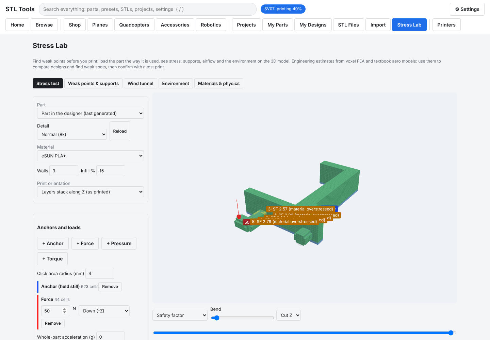 | 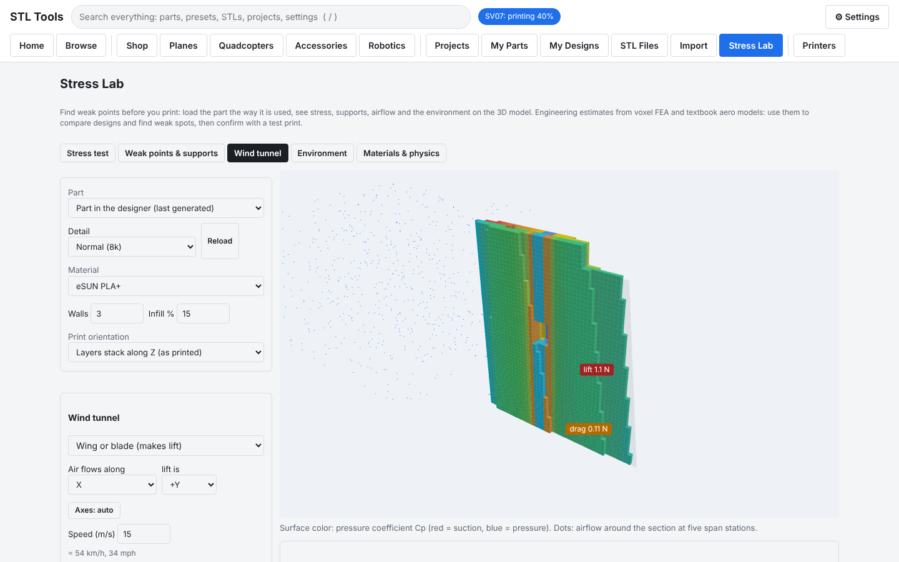 |
| **Stress Lab**: anchors and loads clicked on the part, safety factor map, first places to fail. | **Wind tunnel**: pressure on the wing surface, airflow, lift and drag. |
| 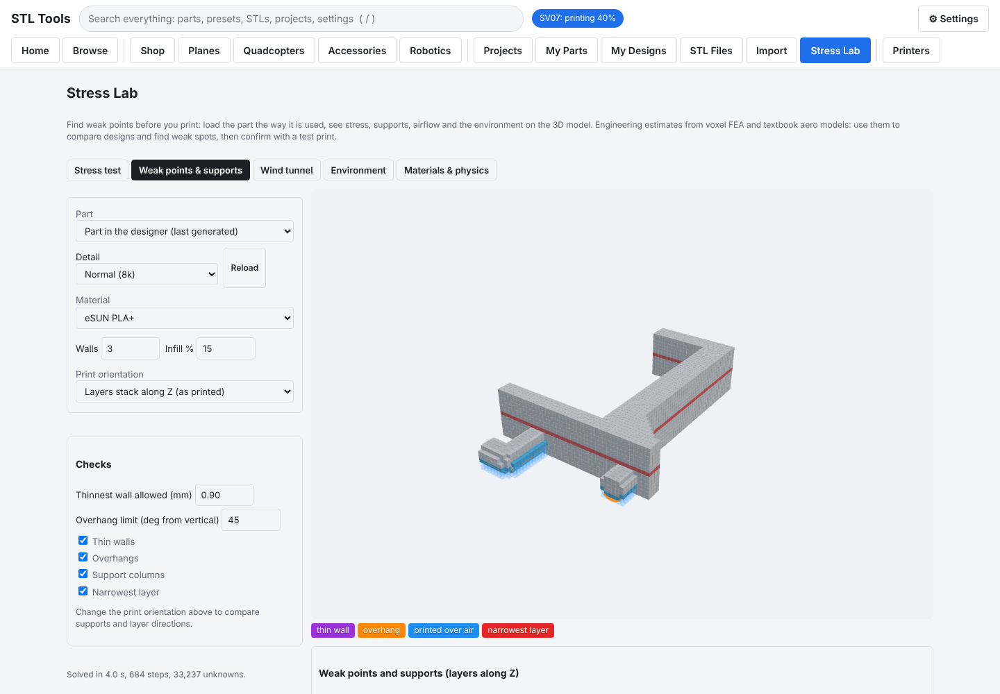 | 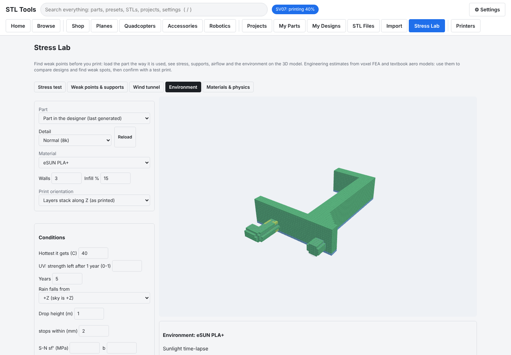 |
| **Weak points and supports** for the chosen print orientation. | **Environment**: heat, UV, rain pooling, moisture, fatigue, drop. |
| 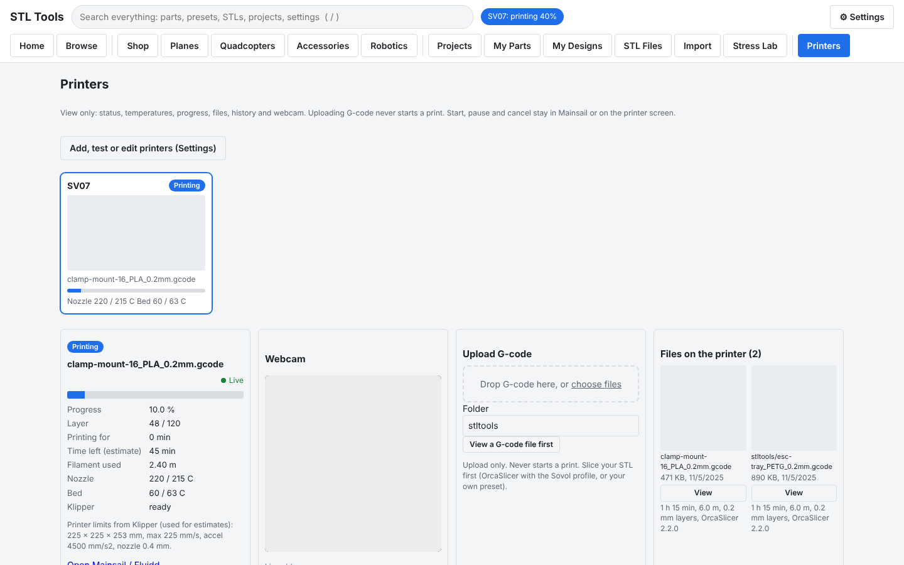 | 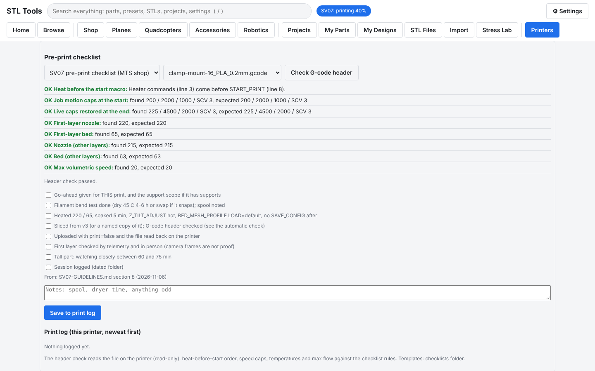 |
| **Printers**: live status from Moonraker, files, upload; direct on your LAN. | **Pre-print checklist**: the header check reads the file on the printer. |
| 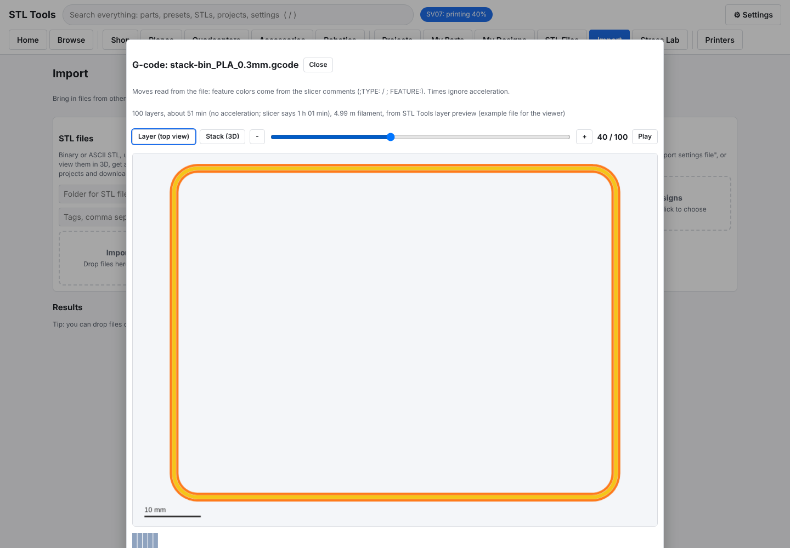 | 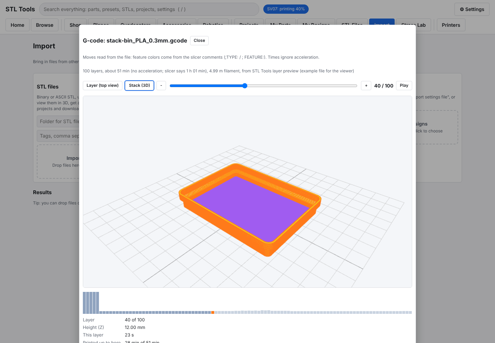 |
| **G-code viewer**: walls, skin and infill by color, time per layer. | **3D stack** up to the chosen layer. |
| 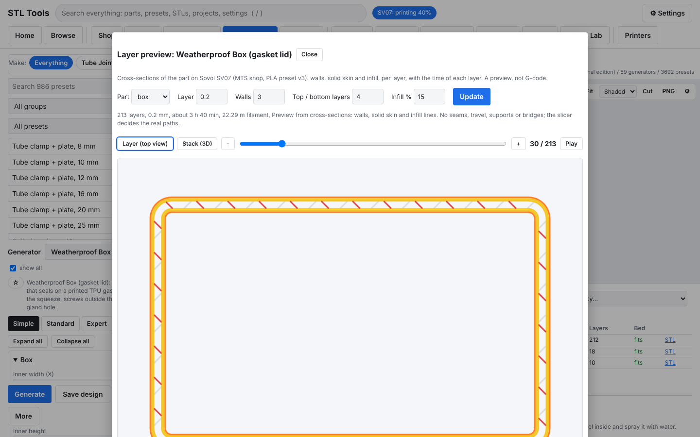 | 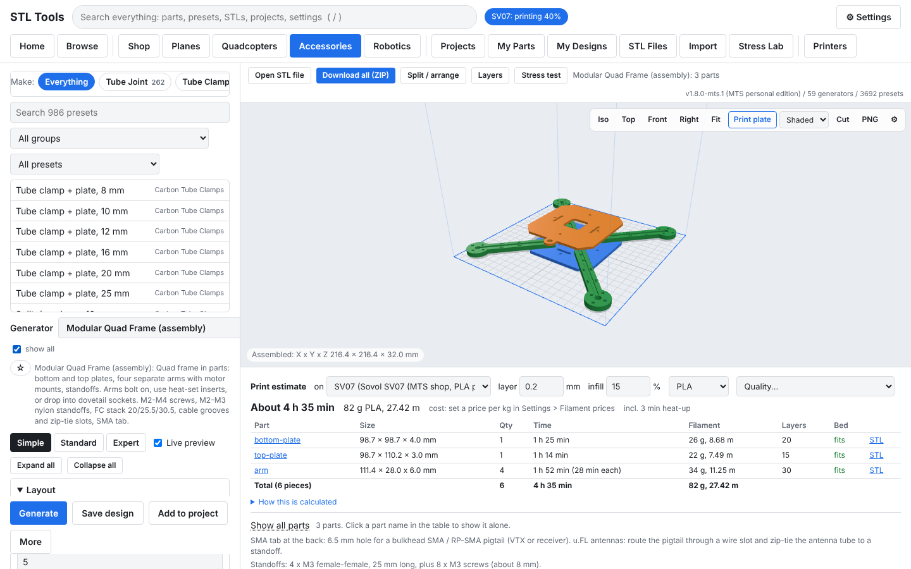 |
| **Layer preview**: walls, skin and infill of your part, per layer. | **Modular quad frame**: plates, 4 arms, standoffs; parts list and estimate. |
|  |  |
| **Designer**: live 3D view, per-part time and filament. | **Browse**: filter 3,661 presets by type, tab, category, tag, collection. |
|  |  |
| **Assemblies**: parts shown put together, time and grams per part. | **Project assembly**: place any parts; per-part times and totals. |
|  |  |
| **Check flags**: datasheet sizes highlighted; the 3D view has its own settings. | **Needs measurement**: no invented sizes. |
|  |  |
| **Tooltips**: range, default and name on every setting. | **My Parts**: ownership, sizes, matching presets. |
|  |  |
| **Global search** (`/`) across parts, presets, STLs, projects, settings. | **Projects**: parts lists, one-ZIP download, export. |
|  |  |
| **Settings > Printers**: connection test step by step. | **Printers**: live webcam, printer limits for estimates; view only. |
|  |  |
| **Import**: STL, project and design files. | **Dark mode**. |
| 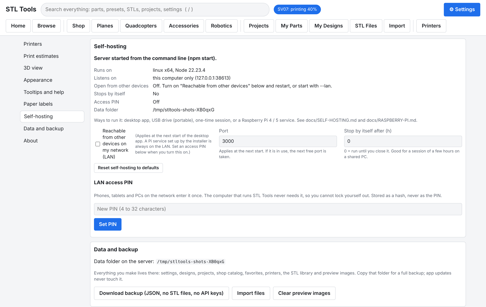 | |
| **Settings > Self-hosting**: run mode, addresses, auto-stop, LAN access PIN. | |

## License and branches

STL Tools is licensed under the [Apache License 2.0](LICENSE); third-party components are listed in [NOTICE](NOTICE).

| Branch | What it is | Releases |
|---|---|---|
| `main` | The public release line, with a generic example parts list. | `v1.0.0` and later ([Latest](https://github.com/opsecfreak/STLTools/releases/latest)); npm package `stltools` |
| `mts-personal` | **MTS personal edition**: the newest public version plus one repair shop's real parts list (98 parts), print ideas, assembly specs and the part-linked presets. Kept up to date by merging `main` into it. | Pre-releases `v<public version>-mts.<n>` (for example `v1.0.1-mts.1`); not on npm |
| `mts-personal-data` | Snapshot of that shop's data as it was in v0.8.0, before the public release. Read-only history. | none |

Contributions: [CONTRIBUTING.md](CONTRIBUTING.md). Developers and AI agents: [AGENTS.md](AGENTS.md).

## Download and run (details)

No install of Node.js or anything else needed: each release package includes it.

1. GitHub > **Releases** > newest release > download the file for your computer (Windows, Mac Apple / Intel, Linux, Raspberry Pi 64 / 32-bit).
2. Unpack it and read `README-FIRST.txt`.
3. Start it: **Start STL Tools.bat** (Windows), **STL Tools.app** (macOS), `./start.sh` (Linux / Pi).

Step-by-step instructions for every system, including a Raspberry Pi shop server: [docs/INSTALL.md](docs/INSTALL.md). What to test first and how to send feedback: [docs/TESTING.md](docs/TESTING.md).

## Documentation

Start at the hub: **[docs/README.md](docs/README.md)** (every guide by goal).

| Doc | Covers |
|-----|--------|
| [docs/INSTALL.md](docs/INSTALL.md) | Download and install on Windows, macOS, Linux, Raspberry Pi; upgrade; uninstall |
| [docs/RASPBERRY-PI.md](docs/RASPBERRY-PI.md) | Raspberry Pi 4 / 4B / 5: SD card, install (package or git), setup, kiosk, update, rollback, backup, Tailscale, uninstall |
| [docs/SELF-HOSTING.md](docs/SELF-HOSTING.md) | Desktop, USB portable, one-time session, auto-stop, LAN, access PIN, printers on or off, start options |
| [docs/USER-GUIDE.md](docs/USER-GUIDE.md) | The app from a first part to your own generators: pick then tune, presets, projects, assemblies, layer preview, split, My Parts, estimates |
| [docs/TROUBLESHOOTING.md](docs/TROUBLESHOOTING.md) | Symptom and fix tables: start-up, browser, generating, printers, Pi |
| [docs/FAQ.md](docs/FAQ.md) | Short answers |
| [SECURITY.md](SECURITY.md) | What is protected, what is not, how to report a problem |
| [docs/TESTING.md](docs/TESTING.md) | First test checklist, test prints, feedback template |
| [docs/EXTENDING.md](docs/EXTENDING.md) | Adding generators and presets without breaking anything; release steps |
| [custom/README.md](custom/README.md) | Your own generators and presets |
| [deploy/README.md](deploy/README.md) | Where to run it, installer and service files, settings |
| [presets/README.md](presets/README.md) | Preset file format, adding your own designs |
| [src/generators/README.md](src/generators/README.md) | Writing a new generator, kernel functions, printability rules |
| [docs/STRESS-LAB.md](docs/STRESS-LAB.md) | Stress test, weak points and supports, wind tunnel, environment, materials and physics settings: how to use them and what the numbers mean |
| [docs/PRINTERS.md](docs/PRINTERS.md) | Printers: add and test your SV07, live updates and console, pre-print checklist, G-code viewer, webcam, printer details, opt-in control, upload, troubleshooting |
| [docs/SLICING-RESEARCH.md](docs/SLICING-RESEARCH.md) | How slicing for the SV07 works (Sovol slicer = OrcaSlicer), options for later |
| [docs/ROADMAP-MTS.md](docs/ROADMAP-MTS.md) | What is done and what comes next in the MTS edition, decisions, dead ends |
| [materials/README.md](materials/README.md) | Filament data from maker datasheets and how to add your own |
| [docs/PRINTER-PROFILES.md](docs/PRINTER-PROFILES.md) | Print time estimates, calibration, adding printer profiles (also by GitHub pull request) |
| [AGENTS.md](AGENTS.md) | For developers and AI agents: commands, hard rules, code map |
| [docs/ARCHITECTURE.md](docs/ARCHITECTURE.md) | How the server, generators, data folder and UI fit together |
| [docs/API.md](docs/API.md) | Every HTTP endpoint with request and response shapes |
| [CHANGELOG.md](CHANGELOG.md) | Versions |
| [CONTRIBUTING.md](CONTRIBUTING.md) | How to add generators, presets and printer profiles by pull request |
| [seed/mts-v1/README.md](seed/mts-v1/README.md) | MTS starter data: parts list, print ideas, assembly specs |

## Wiki: folder guides

Every folder that matters has its own README, so the repository reads like a wiki. Start at [docs/README.md](docs/README.md).

| Folder | What is there |
|---|---|
| [docs/](docs/README.md) | All user and developer guides, by goal |
| [src/core/](src/core/README.md) | The server-side engine: kernel, generation, estimates, printers, projects, settings, layer slicer, splitter |
| [src/core/lab/](src/core/lab/README.md) | Stress Lab engines: voxelizer, finite-element solver, weak points, aerodynamics, environment (methods, accuracy, references) |
| [src/generators/](src/generators/README.md) | Every generator and how to write one |
| [public/](public/README.md) | The browser app: pages, 3D view, Stress Lab UI, layer and G-code viewer |
| [presets/](presets/README.md) | Preset files and their format |
| [printer-profiles/](printer-profiles/README.md) | Shipped printer profiles for estimates |
| [checklists/](checklists/README.md) | Pre-print checklist templates and G-code header rules |
| [materials/](materials/README.md) | Filament datasheet values |
| [custom/](custom/README.md) | Your own generators, presets and profiles, no code change |
| [seed/mts-v1/](seed/mts-v1/README.md) | MTS starter data (parts list, print ideas, assemblies) |
| [deploy/](deploy/README.md) | Raspberry Pi installer and service file |
| [scripts/](scripts/README.md) | Packaging, screenshots, UI smoke test, size series builder |
| [test/](test/README.md) | Test suites by version and the fake Moonraker printer |

## What it makes

58 generators, grouped by tab. Every size is a parameter: tube OD and ID, clearances, wall, bolt size (M2 to M5), hole patterns, angles.

| Tab | Generators | Presets |
|-----|-----------|---------|
| Shop | `drawer-unit` (assembly), `spool-holder`, `drill-guide`, `stack-bin` (stacking bins, label slot / raised / recessed text), `parts-box`, `holder-block` (bits, batteries, SD cards), `hook`, `tool-rack`, `label-card`, `fit-test` (heat-set insert, hole and press-fit test coupons) | 841 |
| Planes | `rc-wing` (wingspan, chords, sweep, washout, spar tubes, ailerons / elevator / rudder cut as separate parts, servo pocket + wire channel), `control-horn`, `servo-mount`, `pin-hinge`, `firewall-mount` (down / right thrust), `fuselage-former`, `rc-wheel` | 247 |
| Quadcopters | `quad-modular` (assembly: plates, 4 separate arms bolted / on heat-set inserts / in dovetail sockets, M2-M4 screws, M2-M3 standoffs, cable grooves, SMA tab), `antenna-tube-holder` (u.FL / IPEX dipole tubes on a standoff, arm or screw), `drone-arm` (printed arms), `multirotor-frame` (3 to 8 arms), `motor-mount` (clamps round or square arm tubes), `prop-guard`, `landing-leg`, `repair-stand` (bench cradles), plus arm mounts for ESCs, receivers, VTX, FC, GPS posts, batteries, lights, wires; Yuneec Typhoon H480 / H520 bench and gear-leg parts (measure first) | 495 |
| Accessories | `cell-holder` (18650 / 21700 / 26650 / AA / AAA packs and storage), `tube-clamp` (split, mount plate, saddle, parallel, cross, snap-on clip, two-piece mid-tube, collar), `component-mount` (tray / board pad / cradle / cup / cable clips / support post on a zip-tie saddle, bolt-on clamp, screw plate or tape: ESCs, receivers, batteries, VTX, FC, GPS posts, lights, sensors, Pi boards), `tube-joint` (straight, elbow, tee, cross, Y, radial hub, 3D corners), `tube-cap` (plug, cap, angled foot), `spacer` (spacers, standoffs, washers, bushings), `gps-mast`, `antenna-mount`, `zip-tie-mount`, `camera-mount`, `action-cam-mount`, `connector-mount`, `fc-adapter`, `soft-grommet`, `damper-plate` | 986 |
| Robotics | `shaft-support` (SK-style rod supports), `servo-gimbal` and `brushless-gimbal` (assemblies), `gear` (spur, helical, herringbone, rack), `pulley` (GT2-style, idler), `stepper-mount` (NEMA 11 / 14 / 17 / 23), `bearing-block`, `shaft-coupler`, `link-bar`, `knob`, `enclosure`, `sbc-case` (Raspberry Pi 5 / 4 / 3 or any board: port windows, fan or vents, ears), `sensor-bracket` (TF-Luna, TFmini, XIAO boards: snap lips, tilt wedge, plate / tube saddle / tape), `lidar-mount` (puck lidar plates), `extrusion-bracket` (2020 / 3030 / 4040), `motor-clamp` (N20, 130, 25 / 37 mm gear motors), `mcu-holder` (XIAO, Pico, ESP32 DevKit, STM32 Blue / Black Pill, Nano: snap-lip cradle or posts, FC stack plate), `pi-camera-case` (Pi Camera Module 2 / 3 class, tripod nut), plus board / sensor / battery mounts | 1092 |

Generators also show in other tabs where they fit (tube clamps under Quadcopters and Robotics, for example). Tick **show all** to pick any generator from any tab.

All parts print without supports. Each part comes out in its print orientation.

## Home, search, favorites, projects

- **Home** shows tabs, your favorites, projects, recent designs and printer status. Type in the search box to search everything.
- **Advanced search** (click "Advanced search"): filter by kind (presets, saved designs, generators, projects), tab, generator, favorites only; sort by match, name, tab or recent. Query syntax:

| Type | Finds |
|---|---|
| `esc 16` | Everything containing both words |
| `"tube clamp"` / `-snap` | Exact phrase / exclude a word |
| `tab:quads` `kind:preset` `gen:tube-clamp` `group:hooks` `tag:esc` `fav:yes` `status:active` | Filters |
| `tubeOD:16` `teeth>=30` `length<20` `bolt:M3` | Any setting, with `:` `=` `>` `<` `>=` `<=` |

- **Grid / List**: every result list has both. Grid cards show a 3D preview. Previews render once in your browser and are cached on the server for every device.
- **Favorites**: the star on any card, in the designer next to the description, or on a project. Stored on the server.
- **Projects**: press **+** on a card or **Add to project** in a designer. Unchanged presets and saved designs are linked (later edits flow through); changed settings are stored as a snapshot. On the project page set quantities, notes and printed checkboxes, and download every part (or only unprinted parts) as one ZIP with a parts list.

## Presets, saved designs and files

- **Presets** are the starting points in each tab. They are JSON files in [`presets/`](presets/); add your own there.
- **Save design** stores the current settings on the server under **My Designs**. Load, Make, Rename, Export or Delete them there. Saved designs survive updates and are shared by every device that opens the server.
- **Export / Import** downloads or loads a `.params.json` file. The CLI reads the same files.
- **Open STL file** shows any STL from your computer in the 3D view (nothing is uploaded).
- **Download all (ZIP)** gets every part of a multi-part design (wing sections and ailerons, clamp halves, box and lid) in one file.

Sizes in preset descriptions (props, batteries, servos, boards, motors) are nominal. Measure your parts before a big print run.

## Shop catalog and labels

The Shop tab tracks every bin in your shop.

1. Pick a category (Props, Motors, Fasteners ... edit the list with **Edit categories**).
2. Enter a name and an optional location (shelf/row).
3. Pick a design (any preset). To customize: load a preset in the Designs tab, change values, press **Add to shop**.
4. Press **Add item**. The item gets a code like `PRP-001` and the bin is generated with the name and code on its label.
5. **Make** generates the bin again. Bins with a card slot also get a matching `label-card` STL.
6. **Print paper labels** opens a sheet sized to each bin's slot, with the category color bar. Print at 100% scale.

Label styles on bins and holders:
- **Card slot**: swap labels when a bin changes use. Use the printed label card or cardstock cut to the reported size.
- **Raised text**: change filament at the first text layer for two colors.
- **Recessed text**: fill with paint marker.

Catalog data (`catalog.json`, `categories.json`), saved designs (`designs.json`), projects, favorites, printers and the preview cache are in `data/` (`STLTOOLS_DATA` to change). Back that folder up.

## Run from source (developers)

Needs Node.js 18 or newer. No build step. No Docker.

```bash
git clone https://github.com/opsecfreak/STLTools.git
```

```bash
cd STLTools
```

```bash
npm install
```

```bash
npm test
```

## Web UI

```bash
npm start
```

Open http://127.0.0.1:3000.

Environment variables: `HOST` (default `127.0.0.1`), `PORT` (default `3000`), `STLTOOLS_DATA` (default `./data`). Set `HOST=0.0.0.0` to open it from a phone or another PC on your LAN, and set an access PIN in Settings > Self-hosting. Do not expose it to the internet. For access away from the shop, use a private VPN such as Tailscale.

## CLI

```bash
node bin/stltools.js presets drone
```

```bash
node bin/stltools.js preset drone-props-5in -o out
```

```bash
node bin/stltools.js preset hook-peg-j --armLength 70 -o out
```

```bash
node bin/stltools.js info stack-bin
```

```bash
node bin/stltools.js gen stack-bin --width 100 --depth 150 --height 70 --compartmentsX 2 --labelType emboss --labelText "M3 SCREWS" -o out
```

Each run writes one STL per part plus `<name>.params.json`. Feed it back with `--params <file>` to rebuild the same part. Other flags: `--ascii`, `--name <prefix>`. Run `npm link` once to use `stltools` as a command.

## Run as a system service (systemd)

On a Raspberry Pi or any Debian-based Linux, the installer does everything (Node.js, service user, `/opt/stltools`, systemd unit), updates an existing install when run again, and removes it with `--uninstall` (keeps your data):

```bash
sudo bash deploy/install-pi.sh
```

From an unpacked release package or a USB drive (no git): `sudo SOURCE_DIR=<package>/app bash <package>/app/deploy/install-pi.sh`. Test it without touching a real install: `sudo bash scripts/test-pi-install.sh`.

See [deploy/README.md](deploy/README.md) for settings and [docs/RASPBERRY-PI.md](docs/RASPBERRY-PI.md) for the full walkthrough.

## API

Every endpoint with request and response shapes: [docs/API.md](docs/API.md). Main ones:

| Method | Path | Purpose |
|--------|------|---------|
| GET | `/api/generators`, `/api/presets`, `/api/version` | What is available |
| POST | `/api/generate/:id` | JSON params in, parts with stats and download URLs out |
| POST | `/api/estimate` | Print time and filament for part stats and a printer profile |
| GET / PUT | `/api/settings` | Settings (partial updates) |
| GET / PUT | `/api/library`, `/api/library/upload` | STL library |
| GET / POST | `/api/projects/:id/export`, `/api/projects/import` | Move projects between computers |
| GET (+ upload) | `/api/printers/...`, POST `/api/printers/diagnose` | Printers: status, files, history, webcam, health, config, mesh, logs (read-only) |
| GET | `/api/printers/:id/stream`, `/api/printers/:id/machine` | Live webcam (MJPEG), printer limits for estimates |
| GET / PUT | `/api/hosting`, `/api/hosting/pin` | How it runs, LAN addresses, access PIN |
| GET | `/api/printers/:id/events` | Live status and console lines (server-sent events, read-only) |
| GET / POST | `/api/printers/:id/gcodecheck`, `/api/printers/:id/checklists` | G-code header check, print log |
| GET / PUT / POST | `/api/printers/:id/control`, `/api/printers/:id/control/:action` | Opt-in printer control (off by default, logged) |
| POST | `/api/layers`, `/api/split` | Layer preview, split and arrange for the bed |
| GET / POST | `/api/materials`, `/api/printer-profiles/import` | Filament data, profile import from slicer files |

## Print notes

**Stacking bins**
- Bins stack only on bins with the same width, depth and wall.
- Dividers stop below the foot of the bin on top.
- Open-front bins: the top bin is held by the foot chamfer at the back. Do not stack them more than 4-5 high without a shelf behind.

**Hooks**
- Hooks print on their side so layer lines run along the arm. Use 4+ perimeters.
- Pegboard pegs sit on one edge of the hook so they touch the bed. Insert the top peg tilted, then rotate down. Load capacity is not rated: test with a light load first.
- 1/4 in board (6.35 mm holes): peg 5.8 mm. 1/8 in board (3/16 in holes): peg 4.4 mm, board 3.2 mm.

**Tool racks**
- Print upright with the shelf on the bed. Pegs have a 45 degree diamond section so they need no support.

**Holder blocks**
- Print a 1 x 2 test block first to tune clearance.

**RC wing**
- Print each section on its root face. Low infill (gyroid 5-8%) or 2-3 perimeters with 0% infill.
- Spar hole = tube OD + 0.1 to 0.2 mm.

**Tube clamps and joints**
- Bore = tube OD + 2 x clearance. 0.1-0.2 mm clearance for a clamp you tighten; negative values grip harder.
- Clamps print with the tube vertical so the ring layers wrap the tube. Joints print flat with teardrop bores.
- PETG, ASA or nylon hold clamping force better than PLA.

**Planes**
- Ailerons, elevators and rudders come out as separate `surfaceN` parts with the hinge gap and a leading-edge bevel. Top hinge = tape hinge; center hinge = pin or CA hinges.
- The servo pocket opens through the bottom skin. A wire channel runs to the root.

**Robotics**
- Gears: mating gears need the same module. Center distance = module x (teeth1 + teeth2) / 2.
- GT2 pulley tooth shape is approximate. Test-fit the belt first.
- NEMA dimensions follow the NEMA standard; check your motor's datasheet.

## How it works

- Geometry kernel: [manifold-3d](https://github.com/elalish/manifold) (WASM, also used by OpenSCAD). Booleans always give closed, consistently oriented meshes.
- Tests check every part of every preset: no open edges, no edges that break after STL float rounding, positive volume, sitting on the bed.
- Text: Roboto Condensed Bold (SIL Open Font License) via opentype.js, turned into outlines and extruded.
- Horizontal holes use a teardrop shape so they print without support.

## Add a generator or preset

- Quickest: **Save design** in the web UI (stored on the server, no files).
- Your own presets and generators: drop them in `custom/` (desktop app: your user data folder). Broken files are skipped, never fatal. See [custom/README.md](custom/README.md).
- Core additions: [docs/EXTENDING.md](docs/EXTENDING.md), [presets/README.md](presets/README.md), [src/generators/README.md](src/generators/README.md).

## Known limits

- Generation runs on the server's main thread. Very large values block other requests until done.
- No user accounts. Anyone who can reach the port (and knows the access PIN, if set) can edit everything.
- WebRTC and HLS webcams show as snapshots (only MJPEG is shown as live video).
- STL only. 3MF (with colors for labels) is on the roadmap.
- No slicing on the server. Slice in your slicer (the Sovol slicer is OrcaSlicer), then upload the G-code in the Printers tab. The layer preview shows walls and infill, not real tool paths.
- Stress Lab and wind tunnel numbers are engineering estimates (linear voxel FEA, inviscid panel method plus skin friction). Compare designs with them and confirm with a test print.
- Printer features are tested against a fake Moonraker in CI; on real printers they are tested on the shop SV07 only.
- Memory grows about 5 MB per 1000 generations (WASM allocator). A service restart clears it.

## Roadmap

MTS edition: [docs/ROADMAP-MTS.md](docs/ROADMAP-MTS.md). Ideas: named physics profiles and saved load cases in the Stress Lab, more filament brands, OrcaSlicer CLI slicing on the PC, Gridfinity-compatible bins, QR codes on labels, 3MF output, cable chains, wing dihedral joiners.
